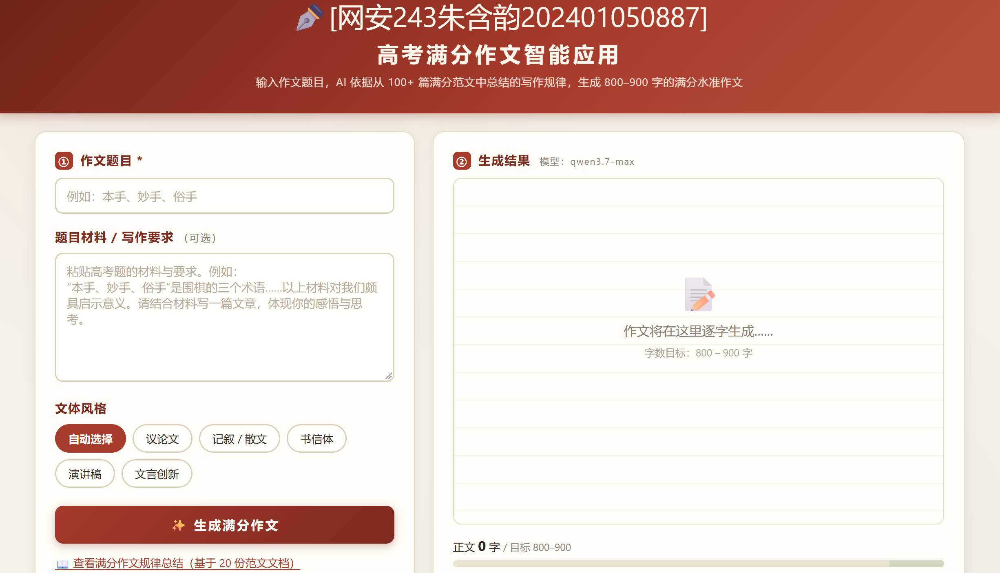
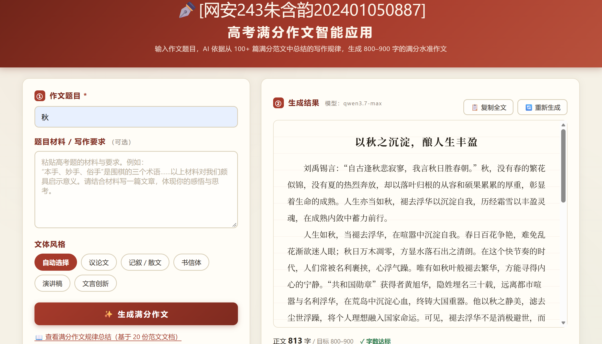
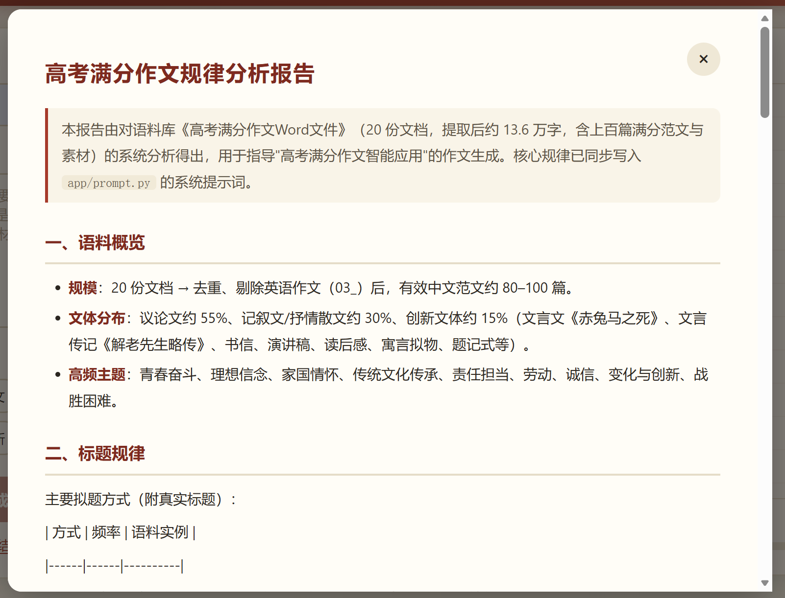

# 高考满分作文智能应用

输入高考作文题目，AI 依据从 **20 份满分作文文档（上百篇范文）** 中总结出的写作规律，生成 800–900 字的满分水准作文。

## 功能特性

- 🎯 **规律驱动**：从语料库系统总结满分作文规律（立意 / 标题 / 开头 / 结构 / 素材 / 名言 / 修辞 / 结尾 / 字数），并写入系统提示词，而非泛泛而谈。
- 🧠 **流式生成**：基于 OpenAI SDK 的异步流式接口，作文逐字生成，体验流畅。
- 📏 **字数把关**：实时统计正文字数（含标点、不含标题），可视化目标区间 800–900 字，达标/偏少/超出三色提示。
- 🎨 **多文体可选**：议论文、记叙/散文、书信体、演讲稿、文言文创新。
- 📖 **规律可视**：页面内可查看完整规律分析报告（`patterns_analysis.md`）。
- 🔌 **模型可替换**：兼容任何 OpenAI 兼容端点（DeepSeek、Moonshot、通义千问等）。

## 技术栈

- **后端**：FastAPI + OpenAI SDK（异步流式，SSE）
- **前端**：原生 HTML / CSS / JavaScript（无外部依赖）

## 目录结构

```
gaokao-essay-app/
├── app/
│   ├── main.py          # FastAPI 应用 + 三个接口
│   ├── prompt.py        # 系统提示词（含满分作文规律 + 文体指令）
│   └── static/          # 前端页面
│       ├── index.html
│       ├── style.css
│       └── app.js
├── patterns_analysis.md # 满分作文规律分析报告
├── requirements.txt
├── .env.example
└── README.md
```

## 快速开始

```bash
cd gaokao-essay-app

# 1. 安装依赖（Python 3.10+）
pip install -r requirements.txt

# 2. 配置环境变量
cp .env.example .env
# 编辑 .env，至少填入 OPENAI_API_KEY

# 3. 启动服务
python -m uvicorn app.main:app --host 127.0.0.1 --port 8000
```

浏览器打开 http://127.0.0.1:8000 即可使用。

## 配置项（.env）

| 变量 | 说明 | 默认值 |
|------|------|--------|
| `OPENAI_API_KEY` | 必填，API Key | — |
| `OPENAI_BASE_URL` | API 地址（可换兼容端点） | `https://api.openai.com/v1` |
| `OPENAI_MODEL` | 模型名 | `gpt-4o-mini` |
| `OPENAI_TEMPERATURE` | 采样温度（留空则不传，o 系列推理模型需留空） | `0.85` |

兼容端点示例：DeepSeek `https://api.deepseek.com/v1`、Moonshot `https://api.moonshot.cn/v1`、通义千问 `https://dashscope.aliyuncs.com/compatible-mode/v1`。

## 接口

| 方法 | 路径 | 说明 |
|------|------|------|
| `POST` | `/api/generate` | 流式生成作文（SSE），入参 `{topic, material?, style?}` |
| `GET` | `/api/health` | 服务与配置状态 |
| `GET` | `/api/patterns` | 满分作文规律分析报告（markdown） |
| `GET` | `/docs` | Swagger 接口文档 |
| `GET` | `/` | 前端页面 |

`/api/generate` 的 SSE 事件：`meta`（模型名）、`delta`（正文片段）、`done`（含 `char_count` / `body_char_count`）、`error`（错误信息）。

## 运行效果






